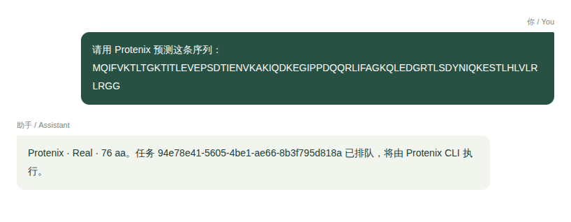
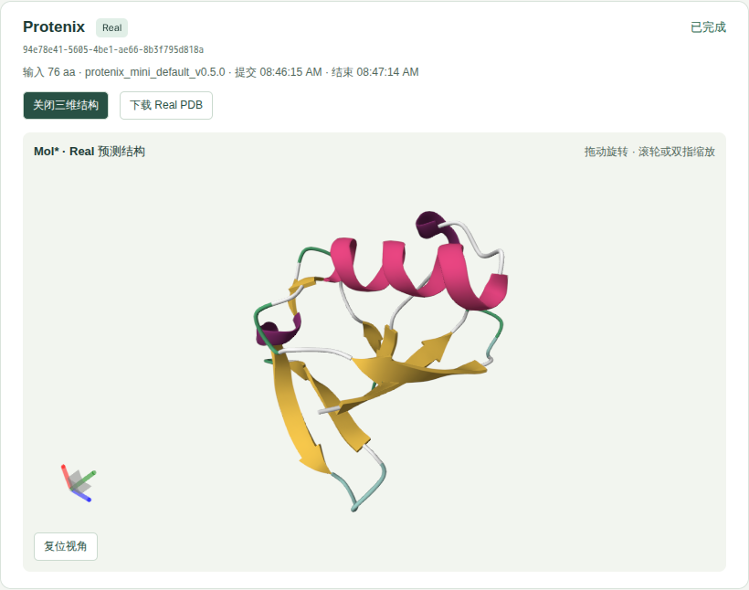

**简体中文** | [English](./README_en.md)
# Protein Chat · 对话式蛋白质结构预测工作台

> **Conversational AI Agent for Protein Structure Prediction**  
> 通过中英文自然语言对话提交单链蛋白质序列，自动编排 **ESMFold2** 与 **Protenix** 结构预测任务，并在浏览器中以 **Mol\*** 进行交互式三维可视化与 PDB 下载。


---

## 界面预览

| 对话交互与异步任务卡片 | Mol\* 三维结构可视化 |
| :---: | :---: |
|  |  |

---

## 核心特性

- **中英文对话式工具调用**：接入 DeepSeek（OpenAI 兼容接口）负责意图理解、缺参追问与上下文指代（如“用 Protenix 再测同一条序列”、“查询该任务状态”）；所有任务入队与状态流转均由后端代码严格把控，不依赖模型幻觉。
- **严格的序列校验与防篡改**：支持单条纯氨基酸序列或单条 FASTA 输入（20 种标准氨基酸，1–500 aa）。后端仅做去空白、转大写与去标题处理，并核验工具调用参数与用户原文一致，绝不静默截断、修补或使用 LLM 猜测的序列。
- **双预测引擎与独立模式切换**：同时集成 **ESMFold2**（OpenProtein / Biohub）与 **Protenix**（本地 GPU CLI / 免费 Colab 协作），两个模型的 `real` 与 `mock` 模式完全解耦，可按需单独启用。
- **无本地 GPU 友好**：
  - **Mock 模式**：内置带来源标注的实验坐标样例（[RCSB PDB 1UBQ](https://www.rcsb.org/structure/1UBQ)），零预测算力即可完整体验对话、轮询、可视化与下载闭环，页面与文件名清晰标识 `mock`。
  - **交互式 Colab 协作模式（`--colab`）**：本地提交序列并导出专属 Notebook，在免费 Google Colab T4 上完成 Protenix 推理后回传结果文件，无需暴露本地密钥，也无需公网穿透。
  - **离线归档回放**：无需配置任何 API Key 或 GPU，可直接加载仓库内附带的真实推理归档包并在浏览器中交互查看。
- **可靠的任务管理与结构校验**：FastAPI + SQLite + 单后台 Worker 顺序执行，按 `data/jobs/<UUID>/` 隔离存储任务输入、事件日志与产物；预测结果须经 **Gemmi** 校验包含有效蛋白质原子坐标后才会标记成功并开放查看/下载。
- **内置 Mol\* 三维查看器**：任务卡片自动轮询状态，完成后即可在页内旋转、缩放、复位视角，并一键下载经校验的 PDB 文件。

---

## 系统架构

```text
React + TypeScript + Vite（聊天界面 / 任务卡片 / Mol* 三维查看器）
        │  HTTP /api（开发态由 Vite 代理至 127.0.0.1:8000）
        ▼
FastAPI（会话管理 / 序列原文校验 / DeepSeek Tool Calling）
        │  事务提交会话、工具记录与任务预留
        ▼
JobService + SQLite（单并发后台 Worker / 隔离目录 data/jobs/<UUID>/）
        │
        ├──▶ ESMFold2Adapter（OpenProtein / Biohub / Mock）
        └──▶ ProtenixAdapter（本地 CLI / 交互式 Colab 回传 / Mock）
        │
        ▼
Gemmi 结构坐标校验 ──▶ 状态轮询 / Mol* 渲染 / PDB 下载
```

### 技术栈

| 层级 | 主要技术 |
| --- | --- |
| **前端** | React 19、TypeScript、Vite 8、Mol\* 5.13.1 |
| **后端** | Python 3.12、FastAPI、Pydantic v2、Uvicorn、HTTPX、SQLite |
| **结构处理** | Gemmi 0.7.5（mmCIF / PDB 解析与原子坐标校验） |
| **大模型与预测引擎** | DeepSeek API、Protenix 2.0.0 (`protenix_mini_default_v0.5.0`)、ESMFold2 (`esmfold2` / `esmfold2-fast-2026-05`) |

---

## 快速开始

### 环境要求

- **Python**：3.11+（推荐 3.12，项目锁定 `3.12.14`）
- **Node.js**：24.x（项目锁定 `24.22.3`）
- **pnpm**：`11.25.0`
- **浏览器**：支持 WebGL 的现代浏览器（已在 Chrome 上验证）

### 1. 克隆项目并安装依赖

```bash
git clone https://github.com/LainWorld/protein-agent-app.git
cd protein-agent-app
bash scripts/setup.sh
```

> 首次安装需要访问 PyPI 和 npm。如依赖锁文件未变更，后续可跳过此步骤。

### 2. 配置服务端环境变量

```bash
cp -n backend/.env.example backend/.env
chmod 600 backend/.env
```

编辑 `backend/.env`，填入你的 DeepSeek API Key（默认配置为双模型 `mock` 模式，不会产生预测算力费用）：

```dotenv
LLM_PROVIDER=deepseek
LLM_BASE_URL=https://api.deepseek.com
LLM_MODEL=deepseek-flash
LLM_API_KEY=your_deepseek_api_key_here

ESMFOLD2_MODE=mock
PROTENIX_MODE=mock
MOCK_DELAY_SECONDS=3
JOB_TIMEOUT_SECONDS=30
```

### 3. 启动前后端服务

在项目根目录打开两个终端，分别执行：

```bash
# 终端 1：启动后端服务（127.0.0.1:8000）
bash scripts/dev-backend.sh

# 终端 2：启动前端开发服务器（127.0.0.1:5173）
bash scripts/dev-frontend.sh
```

服务启动后：
- 打开工作台：`http://127.0.0.1:5173/`
- 查看健康状态：`http://127.0.0.1:5173/api/health`（确认 `llm_configured: true` 及各模型运行模式）
- 查看 OpenAPI 文档：`http://127.0.0.1:8000/docs`

### 4. 快速体验流程

1. 在工作台点击预设示例 **「泛素 · 先发序列」** 并发送，助手会先追问目标模型而不会盲目建单。
2. 回复 `ESMFold2`，页面将创建异步任务卡片并每 2 秒自动轮询状态（排队/运行中仍可继续对话）。
3. 接着回复 `Use the same sequence with Protenix.`，助手会自动复用当前会话已确认的序列创建新任务。
4. 随时追问任务状态（如 `请查询本会话任务 <任务UUID> 的状态`），或在完成卡片上点击 **「查看三维结构」** / **「下载 PDB」**。
5. 尝试发送含非法字符的序列（如 `请用 ESMFold2 预测这条序列：ABCZ123`），后端会直接拦截并提示错误。

> **免 API Key 离线体验真实结构**：如果只想先预览一次完整的真实 Protenix 推理产物，可在完成 `setup.sh` 和 `bash scripts/check.sh` 后直接运行：
> ```bash
> .venv/bin/python colab/round6.py verify examples/outputs/round6-protenix-*.zip
> .venv/bin/python colab/round6.py serve examples/outputs/round6-protenix-*.zip
> ```
> 打开终端打印的本机地址，即可离线旋转、缩放并下载由真实 Protenix Mini 在 T4 GPU 上生成的 76 aa 泛素结构（602 个原子）。

---

## 真实模型接入指南

`ESMFOLD2_MODE` 与 `PROTENIX_MODE` 相互独立，既可在 `backend/.env` 中持久配置，也可在启动后端时通过环境变量临时覆盖。

### 方式一：Protenix + 免费 Google Colab 交互模式（推荐）

适合本地无 GPU 的环境，无需在云端填写本地密钥，也无需配置公网隧道：

1. 使用 `--colab` 参数启动后端（前端正常启动）：
   ```bash
   bash scripts/dev-backend.sh --colab
   ```
2. 在工作台提交 Protenix 预测请求与完整单链序列，运行中的任务卡片会提供**专属 Notebook** 下载（已自动填入本次序列与任务 UUID）。
3. 将 Notebook 上传至 [Google Colab](https://colab.research.google.com/)，切换运行时为免费 **T4 GPU** 并依次运行全部代码单元。
4. 运行完成后会下载 `protenix-result-<任务UUID>.json`，回到本地对应的任务卡片上传该文件。后端会核验任务标识、完整序列与 mmCIF 坐标，通过后即可在 Mol\* 中查看并下载 Real PDB。

> 单次任务交回窗口为 1 小时，期间请保持本地后端运行。

### 方式二：Protenix 本地 / 远端 GPU CLI

如果运行后端的主机已具备 CUDA GPU、隔离安装的官方 Protenix 2.0.0 CLI 及权重缓存目录，可直接启用本地真实推理：

```bash
PROTENIX_MODE=real \
PROTENIX_EXECUTABLE="/path/to/venv/bin/protenix" \
PROTENIX_ROOT_DIR="/path/to/protenix-cache" \
JOB_TIMEOUT_SECONDS=1800 \
bash scripts/dev-backend.sh
```

- 默认模型变体：`protenix_mini_default_v0.5.0`
- 推理参数：seed `101`、4 cycles、5 diffusion steps、1 sample，关闭 MSA 与模板
- 任务目录自动保留 `protenix-input.json`、`cli-events.jsonl`、原始 `.cif` 及校验导出的 `structure.pdb`

<details>
<summary><strong>补充：在 Google Colab 直接运行端到端 / 独立 Protenix Notebook</strong></summary>

仓库在 `colab/` 目录下提供了两个开箱即用的自包含 Notebook：

- **`colab/protenix_chat_round6.ipynb`（端到端工作台）**：内置序列、前后端与校验脚本。上传至 Colab 并选择 **T4 GPU**，在左侧 **Secrets** 添加 `DEEPSEEK_API_KEY` 后依次运行单元 1–7，即可在 Colab 内跑通真实对话、Protenix GPU 推理与浏览器 Mol\* 验收，并导出可离线复核的结果包 `round6-protenix-<UUID>.zip`。
- **`colab/protenix_mini_ubiquitin.ipynb`（独立推理验证）**：无需任何 LLM Key，选择 **T4 GPU** 依次运行单元 1–5，自动安装依赖、下载并校验权重、对 76 aa 泛素执行官方 CLI 推理并导出 `protenix-mini-ubiquitin-<UUID>.zip`（本地可用 `.venv/bin/python colab/ubiquitin.py verify <zip路径>` 复核）。

</details>

### 方式三：ESMFold2 Real（OpenProtein / Biohub）

ESMFold2 支持两个上游提供商，通过 `ESMFOLD2_PROVIDER` 切换：

#### 1. OpenProtein（完整模型 `esmfold2`）

在 `backend/.env` 中配置 `OPENPROTEIN_USERNAME` 和 `OPENPROTEIN_PASSWORD`（参见 [OpenProtein](https://app.openprotein.ai/)）：

```bash
# 探测账号连通性与模型信息
.venv/bin/python scripts/probe_openprotein.py

# 以 OpenProtein Real 模式启动后端
ESMFOLD2_PROVIDER=openprotein ESMFOLD2_MODE=real JOB_TIMEOUT_SECONDS=900 bash scripts/dev-backend.sh
```

> 默认参数：单链 A、无 MSA、1 sample、3 recycles、50 steps、seed `0`。

#### 2. Biohub（快速模型 `esmfold2-fast-2026-05`）

在 [Biohub Developer Console](https://biohub.ai/developer-console/api-keys) 创建 API Key 并填入 `backend/.env` 的 `ESMFOLD2_API_KEY`：

```bash
ESMFOLD2_PROVIDER=biohub ESMFOLD2_MODE=real JOB_TIMEOUT_SECONDS=120 bash scripts/dev-backend.sh
```

> 后端向 `https://biohub.ai/api/v1/fold` 发起单序列无 MSA 同步请求。如遇上游返回 HTTP `451`（地区受限）、`402`（额度不足）或 `429`（限流），任务卡片会如实保留失败状态与原因，不会伪造结果或静默回退到 Mock。

---

## 环境变量参考

完整模板见 [backend/.env.example](backend/.env.example)，修改后需重启后端生效：

| 变量名 | 默认值 | 说明 |
| --- | --- | --- |
| `LLM_PROVIDER` | `deepseek` | 对话模型提供商标识 |
| `LLM_BASE_URL` | `https://api.deepseek.com` | OpenAI 兼容 API 基础地址 |
| `LLM_MODEL` | `deepseek-flash` | 对话与工具调用模型名 |
| `LLM_API_KEY` | *(空)* | 对话模型 API 密钥（仅服务端读取） |
| `ESMFOLD2_MODE` | `mock` | ESMFold2 运行模式：`mock` 或 `real` |
| `PROTENIX_MODE` | `mock` | Protenix 运行模式：`mock` 或 `real` |
| `MOCK_DELAY_SECONDS` | `3` | Mock 任务模拟耗时（秒），便于观察轮询状态 |
| `JOB_TIMEOUT_SECONDS` | `30` | 单次预测任务超时时间（秒）；真实推理建议调大 |
| `ESMFOLD2_PROVIDER` | `biohub` | ESMFold2 上游提供商：`biohub` 或 `openprotein` |
| `ESMFOLD2_API_URL` | `https://biohub.ai` | Biohub API 地址 |
| `ESMFOLD2_MODEL` | `esmfold2-fast-2026-05` | Biohub ESMFold2 模型版本 |
| `ESMFOLD2_API_KEY` | *(空)* | Biohub API 密钥 |
| `OPENPROTEIN_USERNAME` | *(空)* | OpenProtein 账号用户名 |
| `OPENPROTEIN_PASSWORD` | *(空)* | OpenProtein 账号密码 |
| `PROTENIX_EXECUTABLE` | *(空)* | 官方 `protenix` 可执行文件路径（留空则从 `PATH` 查找） |
| `PROTENIX_MODEL` | `protenix_mini_default_v0.5.0` | Protenix 模型变体 |
| `PROTENIX_ROOT_DIR` | *(空)* | 包含 `checkpoint/` 与 `common/` 的缓存根目录 |

---

## API 接口概览

后端运行于 `http://127.0.0.1:8000`（交互式文档位于 `/docs`）：

| 接口 | 说明 |
| --- | --- |
| `GET /api/health` | 检查服务端配置状态（`llm_configured`、`prediction_modes`、`prediction_configured`） |
| `POST /api/chat` | 发送对话消息（支持 `conversation_id` 与幂等 `request_id`），返回助手回复与关联任务回执 |
| `GET /api/conversations/{id}` | 获取指定会话的完整消息记录与关联任务卡片（支持通过 `/?conversation=<UUID>` 恢复） |
| `GET /api/jobs/{id}?conversation_id=...` | 查询任务状态、模式、模型版本、时间戳、错误信息及结果可用性（隔离跨会话访问） |
| `GET /api/jobs/{id}/structure?conversation_id=...` | 获取经 Gemmi 校验的结构坐标；附加 `&download=true` 触发 PDB 文件下载 |

---

## 项目结构

```text
protein-agent-app/
├── backend/                 # FastAPI 后端
│   ├── app/
│   │   ├── adapters/        # ESMFold2 / OpenProtein / Protenix / Colab Handoff / Mock 适配器
│   │   ├── agent.py         # 对话与工具调用编排
│   │   ├── jobs.py          # 单并发后台任务队列与状态机
│   │   ├── sequences.py     # 氨基酸序列与 FASTA 严格校验
│   │   ├── structures.py    # Gemmi 结构解析与 PDB 坐标校验
│   │   └── storage.py       # SQLite 持久化与事务管理
│   └── tests/               # pytest 单元与集成测试
├── frontend/                # React + TypeScript + Vite 前端
│   ├── src/
│   │   ├── App.tsx          # 对话工作台主页面
│   │   ├── JobPanel.tsx     # 异步任务卡片与状态轮询
│   │   └── StructureViewer.tsx # Mol* 三维结构渲染与视角控制
│   └── tests/               # Playwright 浏览器端到端检查
├── colab/                   # Google Colab Notebook 与离线归档校验/回放工具
├── scripts/                 # 安装、启动、冒烟测试、探针与故障演示脚本
├── examples/                # 示例坐标 (1UBQ)、实测归档包与界面截图
├── docs/                    # 开发总结与分阶段验收记录
├── ARCHITECTURE.md          # 系统架构与实现决策
└── PRD.md                   # 产品需求说明
```

---

## 测试与开发验证

所有测试命令均在项目根目录执行：

| 命令 | 验证内容 | 外部消耗 |
| --- | --- | --- |
| `bash scripts/check.sh` | 后端 pytest（临时 SQLite 与可控替身）、前端 TypeScript 类型检查与 Vite 生产构建 | 完全离线 |
| `.venv/bin/python scripts/check_protenix_browser.py` | 使用可控替身与本机 Chrome 端到端验证聊天、Mol\* 渲染、下载与刷新恢复 | 完全离线 |
| `.venv/bin/python scripts/check_protenix_browser.py --round6` | 离线验证回环聊天、结构下载及归档包本地只读复核 | 完全离线 |
| `.venv/bin/python scripts/smoke.py` | 服务启动后检查直连与 Vite 代理的健康接口及 404/422 响应 | 无 LLM 消耗 |
| `.venv/bin/python scripts/smoke.py --live` | 真实 DeepSeek 多轮联调（缺模追问、双 Mock 任务、状态查询、文件校验和） | 少量对话额度 |
| `.venv/bin/python scripts/probe_deepseek.py` | 独立探测 DeepSeek 模型清单与工具调用往返 | 2 次对话补全 |

<details>
<summary><strong>查看隔离故障演示（无需 API 费用，直观测试失败卡片与异常处理）</strong></summary>

可在三个终端分别启动隔离环境（使用独立临时数据库与脚本化替身，不污染主库）：

```bash
bash scripts/demo-failures.sh           # 终端 1：故障演示后端（127.0.0.1:8001）
bash scripts/demo-frontend.sh           # 终端 2：带隔离标识的前端（127.0.0.1:5174）
bash scripts/check-browser.sh --faults  # 终端 3：使用本机 Chrome 自动验证异常与坏文件拦截
```

</details>

---

## 使用说明与局限性

- **输入范围**：当前仅支持**单条**标准蛋白质序列（20 种标准氨基酸，长度 1–500 aa），暂不支持多链复合物、配体或非标准残基。
- **科学精度声明**：Protenix Mini 默认关闭 MSA 与模板以适配免费单卡环境（如 Colab T4），预测结果适合流程验证与教学演示，不作科研级结构精度承诺。
- **部署与安全边界**：本项目定位为**本机单用户工作台**，无鉴权机制，后端默认仅监听 `127.0.0.1` 且单进程单 Worker 运行。请勿直接暴露至公网，也勿将 `backend/.env` 提交至版本库；重启后端后未完成的排队/运行任务会标记为失败而不会自动重跑。

---

## 相关文档与致谢

- 项目文档：[系统架构设计](ARCHITECTURE.md) · [产品需求说明](PRD.md) · [开发总结](docs/development-summary.md) · [验收记录](docs/verification-final.md) · [样例坐标说明](examples/fixtures/README.md)
- 上游项目与工具：[Protenix](https://github.com/bytedance/Protenix) · [ESMFold2 (Biohub)](https://docs.biohub.ai/models/esmfold2) · [OpenProtein](https://docs.openprotein.ai/) · [Mol\*](https://molstar.org/) · [Gemmi](https://gemmi.readthedocs.io/) · [RCSB PDB 1UBQ](https://www.rcsb.org/structure/1UBQ)
