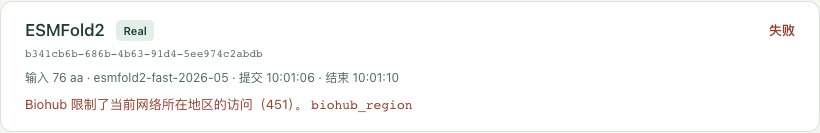

# 第四轮验收 · ESMFold2 Real

**2026-11-20（Asia/Shanghai），未取得泛素的真实预测结构。** 本机聊天页经 DeepSeek 创建了一个 Real 任务。后台携带 Biohub token 向官方接口提交一次折叠请求，收到 **HTTP 451**，任务以 `failed / biohub_region` 结束。下图为实际任务卡。 [原会话](http://127.0.0.1:5173/?conversation=34a160b3-d570-4ee9-8771-6e0d3015e4c2)

## 从聊天到终态

提交前以只读方式检查 SQLite 和任务目录。库中只有第三轮的两个已完成 Mock 任务；任务目录和留存输出均无 Real 结构。后端重读现有本地配置，健康接口经 Vite 返回 ESMFold2 为 `real`、Protenix 为 `mock`，两条路线本地配置均就绪。用户已确认免费额度足以覆盖一次请求。

本轮在独立 Chrome 会话的聊天输入框中发送「请用 ESMFold2 预测这条序列」和完整的项目泛素序列。经过 Vite、FastAPI 和真实 DeepSeek 工具往返，SQLite 留下 **1 轮聊天、1 次非重放的 `predict_structure`、1 个 Real 任务**。浏览器提交使用 `bash scripts/check-browser.sh --submit-real-esmfold2`，只发送了一条聊天消息。另开全新的 Chrome 会话用 `--real-conversation` 复核同一链接，观察到原消息和同一张失败卡，聊天请求数为零。 [原消息与排队回执截图](../examples/screenshots/round-4-chat-b341cb6b-686b-4b63-91d4-5ee974c2abdb.png)

| 核验项 | 本次记录 |
| --- | --- |
| 会话 | `34a160b3-d570-4ee9-8771-6e0d3015e4c2` |
| 任务 | `b341cb6b-686b-4b63-91d4-5ee974c2abdb`，模式 `real`，路线 `esmfold2` |
| 输入 | 聊天原文、SQLite 和任务的 `input.json` 均为同一条 76 aa 泛素。大写序列、不含换行的 SHA-256 为 `233b4b0b8c4616095bc3249f9375fc345d32af7deaef07117d0383c51d6f19aa` |
| 请求 | `POST https://biohub.ai/api/v1/fold`，模型 `esmfold2-fast-2026-05`，`msa=null`，显式请求 JSON 和关闭缓存，未传种子，任务时限 120 秒。平台未返回执行模型标识或坐标 |
| UTC | 02:01:06.962 预留；02:01:08.956 开始；02:01:10.526 失败。北京时间 10:01:10 结束。队列、执行和终态分别由工具回执、数据库及事件日志核对 |
| 输出 | `output_path=null`，结构 SHA-256 为 `null`。本机 `data/jobs/b341cb6b-686b-4b63-91d4-5ee974c2abdb/` 仅有 `input.json` 和 `events.jsonl` |

浏览器实际看到 Real 失败卡和 451 原因，卡片没有画布、查看或下载按钮。预览和附件两个结构请求均为 HTTP 409，刷新后仍是失败。浏览器脚本按约定以退出码 2 报告模型任务失败。**本轮真实结构的坐标核验、Mol* 旋转缩放和成功下载三项均未验收。** 已保留失败状态，没有重交、退回 Mock、购买预测额度、租 GPU 或下载大型权重。账户实际扣用的赠送 credits 未从平台账单核验。

## Biohub 访问和下一步

官方单链折叠入口接受 Bearer API key；`esmfold2-fast-2026-05` 是单序列 Fast 变体。本应用使用已锁定的 HTTPX 0.28.1 与 Gemmi 0.7.5。官方给出的同步上限为 768 tokens，本项目上限为 500 aa。 [模型说明](https://docs.biohub.ai/models/esmfold2) · [fold 协议](https://docs.biohub.ai/api/protein/models/fold) · [同步限制](https://docs.biohub.ai/api/protein/models/overview) · [官方客户端的缓存请求头](https://github.com/Biohub/esm/blob/main/esm/sdk/base_forge_client.py)

接入准备时，从同一台机器向官方入口发出的**无 token、无序列**空请求也返回 451，Credits 网页提示当前地区无法访问。本次带 token 的应用请求重现了 451。现有证据指向网络出口的地区访问限制；账户鉴权、该 key 的模型权限、实际扣额以及推理执行均无法由 451 验证。

若要继续 ESMFold2 实跑，可在 Biohub **Contact us → Contact the team** 提供接口、HTTP 451 和上表 UTC 时间，请平台确认当前地区或所在机构的实验室环境是否获准访问。收到官方确认后再从获准环境新建任务。现有 key 已被后端读到，无需再向聊天提供。 [Biohub 支持](https://biohub.ai/contact)

账户可在 Developer Console 的 **Credits** 核对赠送余额，在 **Rate Limits** 核对 Fast 模型权限。Biohub 接受学术和非营利项目申请额外算力，公开页面给出的审核周期为 30–60 天。本轮记录的免费额度来自用户确认，未在未登录的公开资料中核实统一的赠送数额或单次 76 aa 计价。 [Developer Console](https://biohub.ai/developer-console/api-keys) · [额外研究额度申请](https://info.biohub.org/biohub-additional-compute-credits)

## 离线检查与历史证据

- **本轮重跑** `bash scripts/check.sh`，106 项 pytest 通过，TypeScript 类型检查和 Vite 生产构建通过。`pip check` 未发现依赖冲突。构建仍提示按需加载的 Mol* 块超过 500 kB。
- 本机运行 `.venv/bin/python scripts/smoke.py`，FastAPI 直连和 Vite 代理均通过健康、空消息 422 和未知会话 404 的检查。比对两枚本地凭证后，在任务目录、SQLite、前端构建的 JavaScript 及本轮交付的文档和截图中均未匹配到密钥值。
- 离线成功用例将 1UBQ 实验坐标编码成 Biohub 文档所述的 atom37 测试响应，经过真实适配器、Gemmi、任务库和下载接口。在临时库逐原子对照名称、元素及坐标，并核对查看与下载字节、摘要、会话隔离和模式。该用例只验证本地转换和交付代码。PDB 导出使用三位小数，B 因子栏填零，不表示 pLDDT。 [官方 atom37 顺序](https://github.com/Biohub/esm/blob/main/esm/utils/residue_constants.py)
- 离线故障测试覆盖错误模型、序列或坐标维度、缺失 Cα、损坏 JSON/HTML、重定向、断连、超时、401/402/403/422/429/451/503，及凭证缺失时不提交。对已建任务只尝试一次，失败任务没有可下载文件。
- **历史实测**：第二轮完成真实 DeepSeek 工具往返；第三轮完成两个 Mock 任务，操作真实 Mol* 画布并下载示例。既有两个 `*-mock-*.pdb` 和第三轮截图均保留原归属。 [第二轮](verification-round-2.md) · [第三轮](verification-round-3.md)

## Protenix Real 的资源

下一轮可以开始独立适配器和实验室环境接入。Protenix 目前仍选用 Mock，真实推理次数为零。

| 资源 | 本轮核对结果 |
| --- | --- |
| 算力和运行环境 | 本机为 macOS arm64，PATH 中无 `nvidia-smi`、`nvcc` 或 `protenix`；后端虚拟环境未安装该包，项目未配置 CLI 路径。真实验收需落实免费的实验室 Linux/NVIDIA GPU、匹配的驱动和 CUDA/PyTorch，及独立安装并核对版本的官方 CLI。远程 GPU 配额、显存和实跑耗时均未验实 |
| Mini 权重 | 首选 `protenix_mini_default_v0.5.0`，无 MSA、无模板；实际运行变体尚无。官方默认资源根下缺 `checkpoint/protenix_mini_default_v0.5.0.pt` |
| 数据缓存 | 默认资源根下缺 `common/components.cif`、`common/components.cif.rdkit_mol.pkl`、`common/clusters-by-entity-40.txt`、`common/obsolete_release_date.csv`。当前官方推理初始化会检查这四项 |

第一轮仅对 Mini 权重和两份 CCD 文件读取过响应头，三者合计约 1.17 GB。本轮只查文件是否存在，没有下载、校验、加载或测速。先在已分配的免费环境确认可用 GPU 和磁盘，再锁定官方包版本、核对 `protenix pred -h`，最后从应用提交同一条泛素。 [官方推理说明](https://github.com/bytedance/Protenix/blob/main/docs/training_inference_instructions.md) · [模型表](https://github.com/bytedance/Protenix/blob/main/docs/supported_models.md) · [推理缓存加载](https://github.com/bytedance/Protenix/blob/main/runner/inference.py) · [资源下载映射](https://github.com/bytedance/Protenix/blob/main/protenix/web_service/dependency_url.py)
